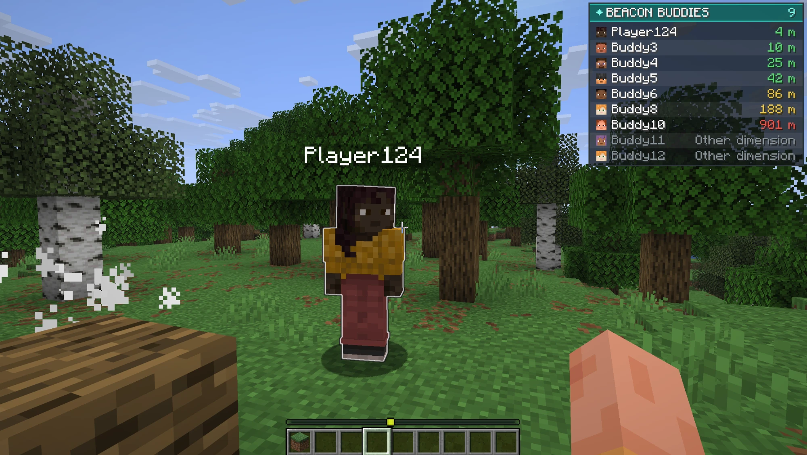
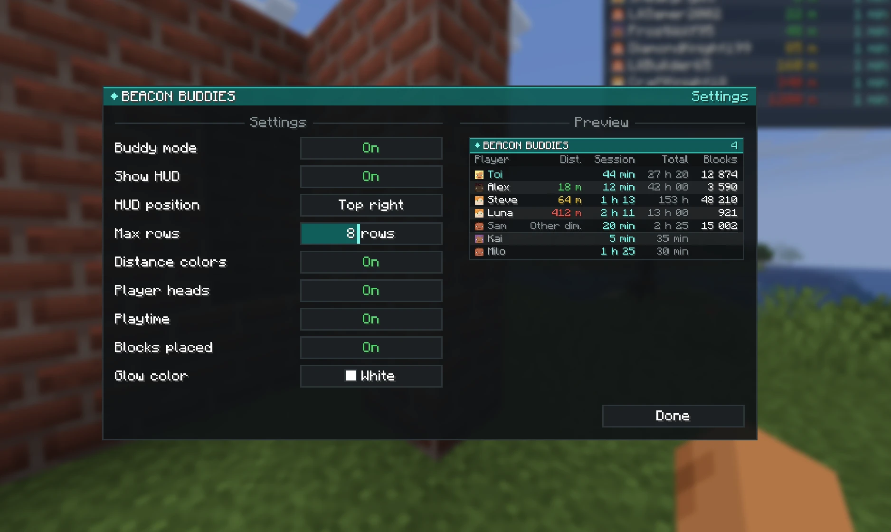

# Beacon Buddies

Mod Fabric **client** pour Minecraft **26.3**. Active le mode, et tu vois en glowing les autres joueurs du serveur qui l'ont activé aussi. Un tableau en haut de l'écran affiche leur distance, leur temps de jeu et leurs blocs posés.

Il marche sur n'importe quel serveur : rien à installer côté serveur, tout passe par un petit relais WebSocket.



## Fonctionnalités

- **Mode mutuel** : tu ne vois que les joueurs qui ont activé le mode, et seuls eux te voient. Les autres ne voient rien de spécial.
- **Glowing** : contour à travers les murs sur les buddies proches, couleur au choix parmi les 16 couleurs de Minecraft.
- **HUD** : un seul tableau, avec une ligne par joueur (tête du skin et pseudo) et une colonne par info.
  - Ordre des lignes : toi en premier (en turquoise), puis tes buddies du plus proche au plus loin.
  - Le chiffre dans la barre de titre est le nombre de buddies.
  - Nombre de lignes réglable, puis "+N autres".
  - Position en haut à droite, à gauche ou au centre. En haut à droite, le tableau se décale sous les icônes d'effets de potion.
- **Distance** (colonne "Dist.") : pour chaque buddy, en vert à moins de 50 blocs, en jaune à moins de 200, en rouge au-delà. "Autre dim." en gris pour ceux qui ne sont pas dans ta dimension.
- **Temps de jeu** (colonnes "Session" et "Total") : pour toi et tes buddies. La session en cours en turquoise, le temps de jeu total sur ce serveur en gris.
- **Blocs posés** (colonne "Blocs") : ton nombre de blocs posés sur le serveur et celui de tes buddies.
- **Team chat** : un chat à part entre tous les joueurs du serveur qui ont le mode actif, avec des messages jusqu'à 2048 caractères. Le serveur Minecraft ne voit pas ces messages.
- **Menu de paramètres** avec aperçu en direct du HUD.
- Le mode repasse sur off à chaque connexion à un serveur.

## Installation

1. Installe [Fabric Loader](https://fabricmc.net/use/) 0.20.1 ou plus récent pour Minecraft 26.3.
2. Mets [Fabric API](https://modrinth.com/mod/fabric-api) dans ton dossier `mods`.
3. Mets le `.jar` de Beacon Buddies dans ton dossier `mods`.

Chaque joueur qui veut voir et être vu doit avoir le mod.

## Utilisation

| Touche | Action |
|---|---|
| `J` | Activer / désactiver le mode |
| `G` | Ouvrir le menu de paramètres |
| `H` | Afficher / cacher le HUD |

Les touches se changent dans **Options > Commandes**, catégorie "Beacon Buddies".

| Commande | Action |
|---|---|
| `/buddies` | Affiche l'état du mode |
| `/buddies on`, `off`, `toggle` | Active, désactive ou inverse le mode |
| `/buddies list` | Liste les buddies avec leur distance dans le chat |

Le mode ne marche qu'en multijoueur (pas en solo ni en LAN).

### Paramètres

Tout se règle dans le menu (`G`) et est sauvegardé dans `config/beaconbuddies.json` :



| Paramètre | Défaut |
|---|---|
| Afficher le HUD | Activé |
| Position du HUD | Haut droite |
| Lignes max (3 à 15) | 8 |
| Couleur selon la distance | Activé |
| Têtes des joueurs | Activé |
| Temps de jeu | Activé |
| Blocs posés | Activé |
| Couleur du glowing | Blanc |

## Comment ça marche

Un mod client ne peut pas parler aux autres clients à travers un serveur vanilla, et il ne connaît que les joueurs proches. Beacon Buddies passe donc par un **relais WebSocket** externe (`wss://beaconbuddies.habibiserver.dev/beaconbuddies`) :

1. Quand tu rejoins un serveur, le mod se connecte au relais avec ton pseudo, ton UUID et l'adresse du serveur (par exemple `play.exemple.net:25565`). Les joueurs sont regroupés par adresse de serveur.
2. Quand le mode est actif, il envoie ta position et ta dimension toutes les 0,5 seconde.
3. Le relais renvoie à chaque joueur actif la liste des autres joueurs actifs du même serveur.

Les positions restent en mémoire : elles ne sont ni enregistrées ni loggées, et disparaissent quand tu te déconnectes.

### Temps de jeu

Quand le mode est actif, le mod signale au relais que tu es en ligne (toutes les 30 secondes). Le relais en déduit tes sessions et les enregistre :

- **Ce qui est stocké** : l'adresse du serveur, l'UUID, le pseudo, et l'heure de début et de fin de chaque session. Jamais d'IP ni de position.
- **Qui y a accès** : uniquement les joueurs connectés au même serveur avec le mode actif. Il n'y a pas d'accès public.
- **Durée de conservation** : les sessions de plus de 90 jours sont supprimées automatiquement.
- **Limite** : seul le temps passé avec le mode actif est compté.

Ça ne concerne **que les joueurs qui ont le mod** et activent le mode : les autres joueurs du serveur ne sont jamais suivis. Pour faire supprimer ton historique, ouvre une issue sur ce dépôt avec ton UUID.

### Blocs posés

Le mod ne compte rien lui-même : il demande au serveur tes statistiques vanilla (les mêmes que dans le menu Statistiques) toutes les 30 secondes et additionne les utilisations de tous les blocs. Le total comprend donc tout ce que tu as posé sur ce serveur, même avant d'installer le mod.

Ton total est envoyé au relais, qui le transmet à tes buddies avec ta position. Il reste en mémoire et n'est pas enregistré. On ne voit que les blocs des joueurs qui ont le mod et le mode actif : un client ne peut pas savoir qui a posé un bloc.

### Team chat

Quand le mode est actif, deux onglets apparaissent au-dessus de la barre de chat (`T`). Ce sont deux chats séparés, chacun avec ses messages et son historique :

- **Global** : le chat normal du serveur.
- **Team** : le team chat. Ce que tu tapes part aux autres joueurs qui ont le mode actif, sans passer par le serveur. Les commandes (`/...`) partent toujours au serveur.

Le chat affiché à l'écran, même fermé, est celui de l'onglet choisi. L'autre onglet affiche le nombre de messages non lus, par exemple "Team (3)".

Les messages passent par le relais, qui les transmet tout de suite sans les enregistrer. Pas d'historique : en activant le mode, tu ne vois que les messages envoyés à partir de là. Le relais limite à 5 messages toutes les 5 secondes.

### À savoir

- **Pas d'authentification** : toute personne qui connaît l'adresse du relais et celle d'un serveur peut voir la position des joueurs qui y ont activé le mode et lire le team chat, voire écrire sous un autre pseudo. N'active le mode que si ça te va.
- **Glowing limité aux joueurs proches** : le glowing ne s'affiche que sur les joueurs chargés autour de toi. Les buddies plus loin restent visibles dans le HUD, avec leur distance.
- **Même adresse obligatoire** : deux joueurs qui rejoignent le même serveur avec deux adresses différentes (un domaine et son IP, par exemple) ne se verront pas.
- **Règles des serveurs** : voir des joueurs à travers les murs peut être interdit sur certains serveurs, même entre amis. Vérifie les règles avant de l'utiliser.

## Compiler depuis les sources

Prérequis : un JDK 25.

```bash
./gradlew build
```

Le `.jar` se trouve dans `build/libs/`.

### Tester à plusieurs en local

```bash
./gradlew runServer
```

Lance un serveur de test dans `run/server`. Mets `eula=true` dans `run/server/eula.txt` (en acceptant l'[EULA Minecraft](https://aka.ms/MinecraftEULA)) et `online-mode=false` dans `server.properties`, car les clients de dev utilisent des comptes hors ligne.

```bash
./gradlew runClient
```

```bash
./gradlew runClient2
```

`runClient2` lance un deuxième client nommé `Buddy2`, dans son propre dossier `run/client2`, qui rejoint `localhost:25565` tout seul.
