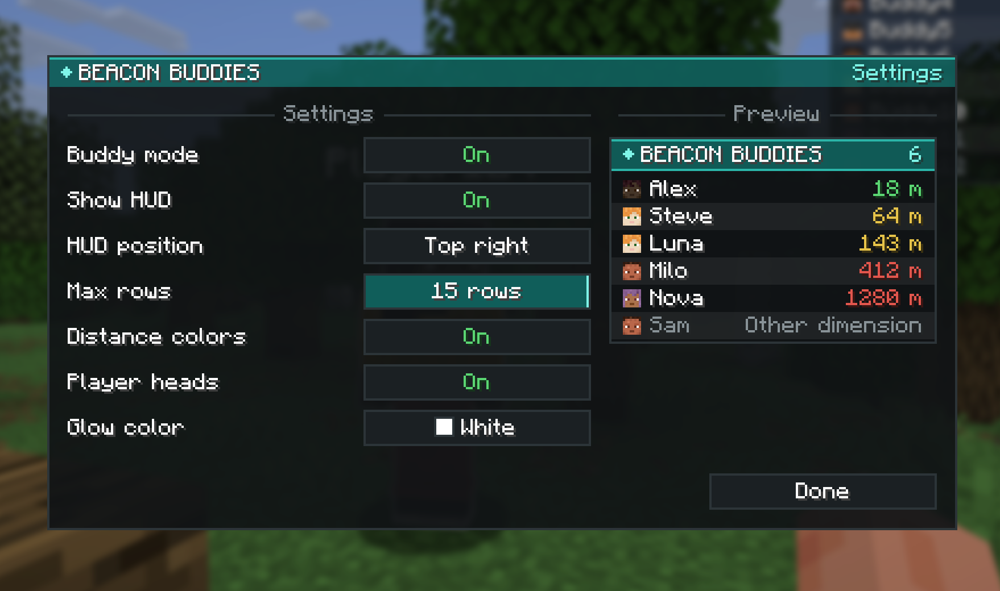

# Beacon Buddies

Mod Fabric **client** pour Minecraft **1.21.11**. Active le mode, et tu vois en glowing les autres joueurs du serveur qui l'ont activé aussi, avec un petit panneau qui affiche leur pseudo et leur distance.

Il marche sur n'importe quel serveur : rien à installer côté serveur, tout passe par un petit relais WebSocket.


## Fonctionnalités

- **Mode mutuel** : tu ne vois que les joueurs qui ont activé le mode, et seuls eux te voient. Les autres ne voient rien de spécial.
- **Glowing** : contour à travers les murs sur les buddies proches, couleur au choix parmi les 16 couleurs de Minecraft.
- **HUD** : tête du skin, pseudo et distance de chaque buddy, triés du plus proche au plus loin.
  - Distance en couleur : vert à moins de 50 blocs, jaune à moins de 200, rouge au-delà.
  - "Autre dimension" en gris pour ceux qui ne sont pas dans ta dimension.
  - Nombre de lignes réglable, puis "+N autres".
  - Position en haut à droite, à gauche ou au centre. En haut à droite, le panneau se décale sous les icônes d'effets de potion.
- **Menu de paramètres** avec aperçu en direct du HUD.
- Rien n'est conservé : le mode repasse sur off à chaque connexion à un serveur.

## Installation

1. Installe [Fabric Loader](https://fabricmc.net/use/) 0.20.1 ou plus récent pour Minecraft 1.21.11.
2. Mets [Fabric API](https://modrinth.com/mod/fabric-api) dans ton dossier `mods`.
3. Mets le `.jar` de Beacon Buddies dans ton dossier `mods`.

Chaque joueur qui veut voir et être vu doit avoir le mod.

## Utilisation

| Touche | Action |
|---|---|
| `J` | Activer / désactiver le mode |
| `G` | Ouvrir le menu de paramètres |
| `H` | Afficher / cacher le HUD |

Les touches se changent dans **Options > Commandes**, catégorie "Beacon Buddies".

| Commande | Action |
|---|---|
| `/buddies` | Affiche l'état du mode |
| `/buddies on`, `off`, `toggle` | Active, désactive ou inverse le mode |
| `/buddies list` | Liste les buddies avec leur distance dans le chat |

Le mode ne marche qu'en multijoueur (pas en solo ni en LAN).

### Paramètres

Tout se règle dans le menu (`G`) et est sauvegardé dans `config/beaconbuddies.json` :



| Paramètre | Défaut |
|---|---|
| Afficher le HUD | Activé |
| Position du HUD | Haut droite |
| Lignes max (3 à 15) | 8 |
| Couleur selon la distance | Activé |
| Têtes des joueurs | Activé |
| Couleur du glowing | Blanc |

## Comment ça marche

Un mod client ne peut pas parler aux autres clients à travers un serveur vanilla, et il ne connaît que les joueurs proches. Beacon Buddies passe donc par un **relais WebSocket** externe (`wss://beaconbuddies.habibiserver.dev/beaconbuddies`) :

1. Quand tu rejoins un serveur, le mod se connecte au relais avec ton pseudo, ton UUID et l'adresse du serveur (par exemple `play.exemple.net:25565`). Les joueurs sont regroupés par adresse de serveur.
2. Quand le mode est actif, il envoie ta position et ta dimension toutes les 0,5 seconde.
3. Le relais renvoie à chaque joueur actif la liste des autres joueurs actifs du même serveur.

Le relais garde tout en mémoire : aucune base de données, aucune position dans les logs, et tout disparaît quand tu te déconnectes.

### À savoir

- **Pas d'authentification** : toute personne qui connaît l'adresse du relais et celle d'un serveur peut voir la position des joueurs qui y ont activé le mode. N'active le mode que si ça te va.
- **Glowing limité aux joueurs proches** : le glowing ne s'affiche que sur les joueurs chargés autour de toi. Les buddies plus loin restent visibles dans le HUD, avec leur distance.
- **Même adresse obligatoire** : deux joueurs qui rejoignent le même serveur avec deux adresses différentes (un domaine et son IP, par exemple) ne se verront pas.
- **Règles des serveurs** : voir des joueurs à travers les murs peut être interdit sur certains serveurs, même entre amis. Vérifie les règles avant de l'utiliser.

## Compiler depuis les sources

Prérequis : un JDK 21. Gradle télécharge lui-même un JDK 25 pour son daemon (exigé par Loom 1.19), le mod reste compilé en Java 21.

```bash
./gradlew build
```

Le `.jar` se trouve dans `build/libs/`.

### Tester à plusieurs en local

```bash
./gradlew runServer
```

Lance un serveur de test dans `run/server`. Mets `eula=true` dans `run/server/eula.txt` (en acceptant l'[EULA Minecraft](https://aka.ms/MinecraftEULA)) et `online-mode=false` dans `server.properties`, car les clients de dev utilisent des comptes hors ligne.

```bash
./gradlew runClient
```

```bash
./gradlew runClient2
```

`runClient2` lance un deuxième client nommé `Buddy2`, dans son propre dossier `run/client2`, qui rejoint `localhost:25565` tout seul.
